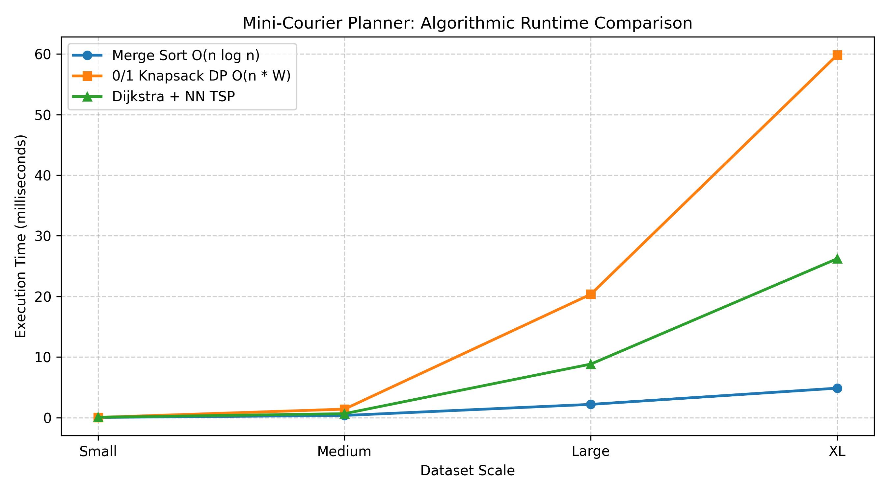
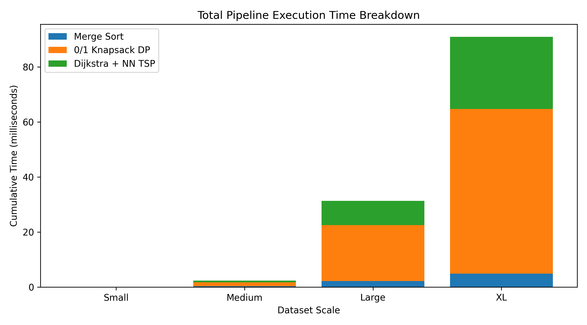

# Mini-Courier Planner — DAA Capstone Assignment (ETCCDA302)

**Student Name:** Sanchit Upneja  
**Roll Number:** 2501730475  
**Programme:** B.Tech CSE (AI & ML)  
**Course:** Design & Analysis of Algorithms (`ETCCDA302`)  
**Faculty:** Dr. Shweta Agarwal  
**Institution:** School of Engineering & Technology (SOET), K.R. Mangalam University  

---

## 1. Problem Statement
**Mini-Courier Planner** is an integrated Python prototype designed to simulate an intelligent courier logistics system. Given a list of parcels (with weights, priority scores, destinations, and delivery deadlines) and a weighted road network graph, the system generates:
1. A prioritized queue of parcels based on urgency and importance.
2. An optimal packing plan that maximizes total priority without exceeding the delivery vehicle's weight capacity.
3. A shortest-distance multi-stop delivery route starting and ending at the central courier depot (`Node 0`).

---

## 2. System Architecture & Algorithmic Pipeline

```text
Raw Parcels & City Graph
         │
         ▼
[Phase 2A] Merge Sort ──────────────► Prioritizes parcels by earliest deadline & highest priority
         │
         ▼
[Phase 2B] 0/1 Knapsack (DP) ───────► Selects optimal parcel subset within van capacity (W)
         │
         ▼
[Phase 3]  Dijkstra + NN-TSP ───────► Computes shortest paths & builds closed delivery loop
         │
         ▼
[Phase 4]  Benchmarking & Charts ───► Measures execution runtime across Small to XL datasets
```

### Algorithms Implemented
| Pipeline Stage | Module | Algorithm / Paradigm | Time Complexity | Space Complexity |
| :--- | :--- | :--- | :--- | :--- |
| **Parcel Prioritization** | `sorting.py` | **Merge Sort** (Divide & Conquer) | $O(n \log n)$ | $O(n)$ |
| **Box / Van Filling** | `knapsack.py` | **0/1 Knapsack** (Dynamic Programming) | $O(n \times W)$ | $O(n \times W)$ |
| **Shortest Paths** | `graph_routing.py` | **Dijkstra's Algorithm** (Min-Heap Greedy) | $O((V + E) \log V)$ | $O(V + E)$ |
| **Delivery Tour** | `graph_routing.py` | **Nearest-Neighbor TSP** (Approximation) | $O(k^2)$ | $O(k)$ |

*(Where $n$ = number of parcels, $W$ = vehicle capacity, $V$ = graph nodes, $E$ = graph edges, and $k$ = unique selected delivery stops.)*

---

## 3. Repository Structure

```text
DAA Capstone/
├── charts/
│   ├── pipeline_breakdown.png
│   └── runtime_comparison.png
├── datasets/
│   ├── small_dataset.json
│   ├── medium_dataset.json
│   ├── large_dataset.json
│   └── xl_dataset.json
├── screenshots/
│   ├── DAA ss-1.png
│   ├── DAA ss-2.png
│   └── DAA ss-3.png
├── benchmark.py
├── graph_routing.py
├── knapsack.py
├── main.py
├── sorting.py
├── .gitignore
└── README.md
```

---

## 4. How to Run

### Prerequisites
- Python 3.8+
- `matplotlib` (for generating runtime comparison charts)

```bash
pip install matplotlib
```

### Execution Steps
1. **Run the End-to-End Planner (Small Dataset with DP Table Preview):**
   ```bash
   python main.py
   ```
2. **Run Multi-Scale Benchmarks & Generate Runtime Charts:**
   ```bash
   python benchmark.py
   ```

---

## 5. Experimental Results & Performance Benchmarks

### Small Dataset Output (`7 parcels, 6 nodes, 15 kg capacity`)
- **Selected Parcels (4):** `['P107', 'P101', 'P105', 'P104']`
- **Capacity Utilized:** `15 / 15 kg` | **Maximum Priority Score:** `290`
- **Optimized Delivery Route:** `0 -> 2 -> 3 -> 5 -> 0`
- **Total Route Distance:** `26 km`

### Multi-Scale Runtime Comparison
| Dataset Scale | Merge Sort (ms) | 0/1 Knapsack DP (ms) | Dijkstra + NN-TSP (ms) | Total Route Distance (km) |
| :--- | :---: | :---: | :---: | :---: |
| **Small** (`10 parcels, 6 nodes`) | `0.0302` | `0.0386` | `0.0595` | `26` |
| **Medium** (`100 parcels, 25 nodes`) | `0.3532` | `1.3972` | `0.6489` | `152` |
| **Large** (`500 parcels, 80 nodes`) | `2.1841` | `20.3575` | `8.8335` | `420` |
| **XL** (`1000 parcels, 150 nodes`) | `4.8602` | `59.8487` | `26.2273` | `776` |

### Visual Evidence
#### Runtime Comparison & Pipeline Breakdown



#### Terminal Execution Traces


---

## 6. Future Optimizations
1. **Space-Optimized Knapsack:** Reduce 0/1 Knapsack auxiliary space from $O(n \times W)$ to $O(W)$ using a 1D rolling array when backtracking is not required, or use branch-and-bound for large continuous capacities.
2. **2-Opt Local Search for TSP:** Refine the Nearest-Neighbor TSP route using 2-opt edge swaps to eliminate crossing paths and reduce total travel distance further.
3. **Dynamic Traffic Weights:** Integrate time-dependent edge weights in Dijkstra's algorithm to account for peak-hour congestion and strict parcel delivery windows.